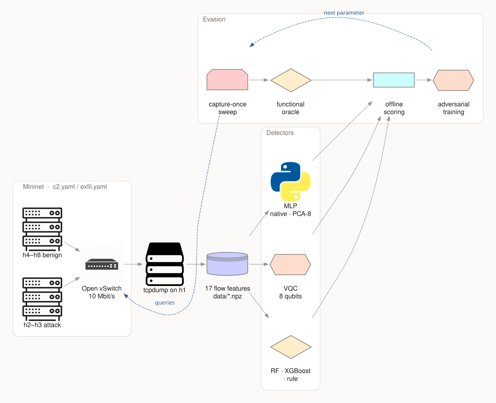

# q-ids

**Problem-space adversarial robustness of ML-based network intrusion detection.** How much
*realizable* traffic change does it take for an attack to slip past a trained flow-level detector,
measured on real traffic rather than on the feature vector, and does a quantum-classical classifier
(PennyLane VQC) hold up any better than a classical one (NumPy MLP)?

> **Status:** experiments complete for two attack families (C2 beaconing and data exfiltration).
> The paper is being prepared for *Computers & Security* in [`paper/tex/`](paper/tex/).

## Key findings

Six detectors (MLP on all 17 features and on PCA-8, an 8-qubit VQC on PCA-8, Random Forest, XGBoost,
a single-feature rule), 30 attack instances per family. Evasion counts only attacks a detector caught
unmodified.

| | C2 beaconing | Data exfiltration |
|---|---|---|
| What the detectors key on | timing regularity (`cv_iat`) | throughput (`bytes_per_second`) |
| Clean test accuracy | 0.841–0.857 learned; rule 0.619 | 0.801–0.889 learned; rule 0.880 |
| Evaded by working traffic | 159 of 160 caught attacks, median timing jitter ±20–30% | 167 of 167, send rate cut 2.5–3×, transfer 3.3 s → 4.9–6.0 s |
| VQC vs MLP on the same inputs (10 training seeds) | VQC easier to evade in 8 of 10 seeds; lowest clean accuracy in 9 of 10 | VQC easier to evade in 8 of 10 seeds; lowest clean accuracy in 10 of 10 |
| Adversarial training on the attacked axis | stops jitter for the MLPs and trees; payload padding then evades every hardened detector | trees stop throttling; a new volume, chunk jitter or chunk size evades them again |
| Stricter threshold (more false positives) | trees stop jitter alone at 23–24% benign FPR; padded beacons need 34% (Random Forest) or more | throttling stopped only at 44–49% FPR; never for the VQC |
| Joint timing + size training | jitter 0.3 plus padding evades the MLPs and VQC on 6–9 of 9 in every seed, XGBoost on 2–7; the Random Forest holds (2 of 9) | not run |

Clean accuracy is deliberately *not* 100%: the benign traffic includes services that genuinely
resemble the attack (regular health checks for C2, large legitimate transfers for exfiltration). An
earlier saturated version of the task produced an apparent quantum "edge" that disappeared once
detection was made realistic.

## Problem space, not feature space

- A **feature-space** attack edits the feature vector directly (`x' = x + δ`). The result may not
  correspond to any traffic that could actually be sent.
- A **problem-space** attack changes the *traffic itself*: the candidate is generated as real packets,
  captured, run through the detector's own feature pipeline, and scored.

Here every candidate is also checked by a **functional oracle**: an evasion only counts if the attack
still works (the beacon keeps checking in; the full payload still arrives before a deadline).
The MLP and the VQC are trained on **matched inputs** (the same 8 PCA components), so a robustness
difference between them comes from the model, not from what it sees. Random Forest, XGBoost and the
rule use all 17 features and stand in for what a defender would deploy.

## Pipeline

<picture>
  <source media="(prefers-color-scheme: dark)" srcset="docs/pipeline-dark.svg">
  
</picture>

1. **Traffic**: each scenario ([`configs/scenarios/c2.yaml`](configs/scenarios/c2.yaml),
   [`exfil.yaml`](configs/scenarios/exfil.yaml)) runs 8 Mininet hosts on one Open vSwitch with
   10 Mbit/s links and NIC offloads off, for 60 s per run, 180 runs per family. tcpdump records on the
   collector host h1. Each flow is labelled by its sender's role, so labels are exact.
2. **Features**: packets are grouped into flows keyed by (protocol, source MAC, destination), and 17
   flow statistics are extracted ([`features/dataset.py`](features/dataset.py)).
3. **Detectors**: a from-scratch NumPy MLP (no ML framework) on all 17 features and on PCA-8, a
   PennyLane VQC on PCA-8 (8 qubits, 4 entangling layers, `default.qubit` simulator), and Random
   Forest, XGBoost and a single-feature threshold rule. All six flag a flow when P(benign) < 0.5.
4. **Capture-once sweep**: every attack instance is run as real traffic at every point of a parameter
   grid (C2: timing jitter or payload-size jitter; exfiltration: throttle) inside the full training
   scenario, and a functional oracle checks each flow: the beacon keeps checking in with no gap over
   30 s, or the payload reaches the collector within 60 s.
5. **Offline scoring**: the saved flows are scored against every detector, so all detectors see
   identical traffic. This gives evasion rates, minimal evading perturbations, paired comparisons and
   transfer rates.
6. **Adversarial training**: evaded flows from 21 instances are added to training and the 9 held-out
   instances are re-scored. Escalation then sweeps a parameter the hardening never varied (payload
   size for C2; volume, chunk jitter or chunk size for exfiltration). For C2, a second round hardens on
   timing and size together and is tested on combinations of the two.

## Repository layout

```
q-ids/
├── topology/      Mininet topology and batch scenario runner
├── traffic/       traffic generators (periodic client, exfil client/sink, benign services)
├── capture/       tcpdump wrapper (runs inside the host's network namespace)
├── features/      flow feature extraction, dataset utilities, shared preprocessing
├── models/        NumPy MLP (+ gradient check) and PennyLane VQC, with trainers
├── evaluation/    from-scratch metrics and the model comparison harness
├── evasion/       query primitive, functional oracles, sweeps, transfer, hardening
├── configs/       model configs and scenario configs (c2.yaml, exfil.yaml)
├── data/          flow datasets used by the paper (dataset, exfil_dataset, real_benign .npz)
├── results/       trained detectors (clean, hardened, jointly hardened), sweeps and evaluation JSON
├── paper/         LaTeX source, figure and realism-check scripts, section drafts
└── docs/          README pipeline diagram and its generator (make_pipeline_diagram.py, mingrammer diagrams)
```

`configs/scenarios/{synflood,recon,spoof,mixed,benign}.yaml` and `traffic/attack/` belong to an
earlier design. They are kept for history and are not used by the paper.

## Prerequisites

- **Linux** for traffic generation (Mininet needs network namespaces and Open vSwitch). Training,
  evaluation and offline scoring run anywhere.
- System packages: `mininet openvswitch-switch tcpdump ethtool` (Arch: Mininet from the AUR).
- Capture steps need root. **All traffic is confined to the emulated Mininet hosts** (private
  addresses inside the virtual topology). Do not point any generator at real networks.

## Setup

```bash
git clone https://github.com/shek014/q-ids.git
cd q-ids
python -m venv .venv && source .venv/bin/activate
pip install -r requirements.txt          # pinned versions used for the paper (Python 3.14)
```

Mininet lives in the system Python; the models live in the venv. The capture half of each query is
run by `/usr/bin/python3`, the scoring half by `.venv/bin/python`. Before any capture:

```bash
sudo modprobe openvswitch veth
sudo systemctl start ovsdb-server ovs-vswitchd
```

## Reproducing the results

Every artifact the paper uses is committed: the flow datasets in `data/`, and the trained detectors and
sweeps in `results/`. The steps below regenerate them. Steps marked *root* capture traffic in Mininet;
everything else runs offline in the venv. Root-run steps leave `results/` and `capture/` owned by root,
so run `sudo chown -R $USER results capture data` before the offline steps. The blocks use bash; in
zsh, expand the option variables as `${=G}`.

### C2 beaconing

```bash
# 1. datasets (root): 60 runs at seed 0 and 120 at seed 1, extracted and concatenated in that order
sudo python3 -m topology.run --scenario configs/scenarios/c2.yaml --out capture/c2   --runs 60
sudo python3 -m topology.run --scenario configs/scenarios/c2.yaml --out capture/c2_b --runs 120 --seed 1
python -m features.extract --pcap-dir capture/c2   --out data/dataset_60runs.npz
python -m features.extract --pcap-dir capture/c2_b --out data/c2_b.npz
python -c "import numpy as np; a,b=np.load('data/dataset_60runs.npz'),np.load('data/c2_b.npz'); np.savez('data/dataset.npz', X=np.vstack([a['X'],b['X']]), y=np.concatenate([a['y'],b['y']]), feature_names=a['feature_names'], class_names=a['class_names'])"

# 2. detectors (the rule defaults to cv_iat for C2)
python -m models.classical.train --data data/dataset.npz --out results/classical_native
python -m models.classical.train --data data/dataset.npz --out results/classical_matched --pca-components 8
python -m models.quantum.train   --data data/dataset.npz --out results/quantum
python -m models.baselines.train --kind rf        --out results/rf
python -m models.baselines.train --kind xgb       --out results/xgb
python -m models.baselines.train --kind threshold --out results/threshold
python -m evaluation.compare --out results/comparison

# 3. capture-once sweeps (root): 3 intervals x 10 seeds, in the full training scenario
G="--intervals 2,4,8 --seeds-per-config 10"
S="--values 0,0.05,0.1,0.15,0.2,0.3,0.4,0.6"
sudo .venv/bin/python -m evasion.sweep $G --jitters 0.0,0.05,0.1,0.15,0.2,0.25,0.3,0.4,0.5,0.8 --out results/evasion/sweep.npz
sudo .venv/bin/python -m evasion.sweep $G --axis size_jitter --fixed-jitter 0.5 $S --out results/evasion/sweep_sizeaxis_full.npz
sudo .venv/bin/python -m evasion.sweep $G --axis size_jitter --fixed-jitter 0.5 $S --only-heldout --out results/evasion/sweep_sizeaxis.npz
sudo .venv/bin/python -m evasion.sweep $G --axis size_jitter --fixed-jitter 0.3 $S --only-heldout --out results/evasion/sweep_combined_heldout.npz

# 4. offline scoring, single-axis hardening, joint hardening
python -m evasion.transfer                                   # native MLP vs VQC -> transfer.json
for b in rf xgb threshold; do
  python -m evasion.transfer --quantum results/$b --out results/evasion/transfer_mlp_vs_$b.json
done
python -m evasion.harden                                     # -> results/*_hardened
python -m evasion.harden_eval --out results/evasion/harden_eval.json
python -m evasion.joint_harden                               # -> results/*_joint_hardened
python -m evasion.joint_eval                                 # -> results/evasion/joint_harden_eval.json
```

### Data exfiltration

```bash
# 1. datasets (root), same layout as C2
sudo python3 -m topology.run --scenario configs/scenarios/exfil.yaml --out capture/exfil   --runs 60
sudo python3 -m topology.run --scenario configs/scenarios/exfil.yaml --out capture/exfil_b --runs 120 --seed 1
python -m features.extract --pcap-dir capture/exfil   --out data/exfil_dataset_60runs.npz --classes benign,exfil
python -m features.extract --pcap-dir capture/exfil_b --out data/exfil_b.npz              --classes benign,exfil
# concatenate exfil_dataset_60runs + exfil_b into data/exfil_dataset.npz as in C2 step 1

# 2. detectors: as C2 step 2 with --data data/exfil_dataset.npz and --out results/exfil_<name>
#    (the rule defaults to bytes_per_second for exfiltration)

# 3. throttle sweep and escalation sweeps (root)
sudo .venv/bin/python -m evasion.exfil_sweep --volumes 800000,1150000,1500000 --seeds-per-config 10 \
  --throttles 0,0.5,1,1.5,2,2.5,3,5,8,12 --out results/evasion/exfil_sweep.npz
E="--volumes 950000,1300000 --seeds-per-config 3 --throttles 0,2,3,5,8,12"
sudo .venv/bin/python -m evasion.exfil_sweep $E                    --out results/evasion/exfil_esc_volume.npz
sudo .venv/bin/python -m evasion.exfil_sweep $E --jitter 0.3       --out results/evasion/exfil_esc_jitter.npz
sudo .venv/bin/python -m evasion.exfil_sweep $E --chunk-size 8192  --out results/evasion/exfil_esc_chunk.npz

# 4. offline scoring and hardening
python -m evasion.exfil_transfer
python -m evasion.exfil_harden                               # -> results/exfil_*_hardened
python -m evasion.exfil_harden_eval --out results/evasion/exfil_harden_eval.json
```

### Realism check and figures

`data/real_benign.npz` comes from the public
[CTU-Normal-29](https://mcfp.felk.cvut.cz/publicDatasets/CTU-Normal-29/) capture: the host's outbound
packets, cut into 60 s windows and run through the same feature extraction.

```bash
tcpdump -r 2017-05-01_normal.pcap -w out.pcap 'src host 10.0.2.15'
mkdir -p win && editcap -i 60 out.pcap win/w.pcap
python -m features.extract --pcap-dir win --out data/real_benign.npz

python paper/realism_check.py                # -> paper/figures/fig6_realism.pdf
python paper/make_figures.py                 # -> paper/figures/fig1-fig5, fig7 (after operating_point)
cp paper/figures/*.pdf paper/tex/figures/
```

### Paper tables and training-seed variation

```bash
python paper/make_tables.py --json results/evasion/paper_tables.json   # every results table in the paper
python -m evasion.operating_point                                      # matched-FPR analysis (Fig. 7 data)
python -m evasion.seed_variance --seeds 0-4 &                           # retrain all detectors, seeds 0-9,
python -m evasion.seed_variance --seeds 5-9 &                           # and rescore the saved sweeps
wait && python -m evasion.seed_variance --summarize                     # median [min, max] across seeds
```

The JSON summaries from the earlier steps count every attack instance. `paper/make_tables.py` applies
the paper's conventions (an attack counts only if the detector flagged it unmodified; Wilson 95%
intervals), defined in [`evasion/paper_metrics.py`](evasion/paper_metrics.py). The seed study keeps the
data split fixed and varies only the model seed; seed 0 reproduces the paper's detailed tables.

## Non-goals

- **Quantum advantage.** Nothing runs on quantum hardware; `default.qubit` is a classical simulator.
  The VQC is one architecture under test.
- **Feature-space results presented as realizable.** Every reported evasion was generated as real
  traffic and passed the functional oracle.
- **Benchmark leaderboard numbers.** The traffic is self-generated in an emulated testbed, so absolute
  accuracy is not comparable to CIC-IDS2017 or UNSW-NB15 results. A benchmark cross-check is planned as
  separate work.
- **General-purpose intrusion detection.** The study covers two attack families whose function is
  separable from their traffic shape. Volumetric attacks (floods, scans) are out of scope, because their
  detectable signature *is* their function.

## Citation

Code and data are archived on Zenodo: [10.5281/zenodo.23180177](https://doi.org/10.5281/zenodo.23180177) (resolves to the latest version).

## License

MIT, see [LICENSE](LICENSE). Copyright (c) 2026 Abhishek Ravicharan.
