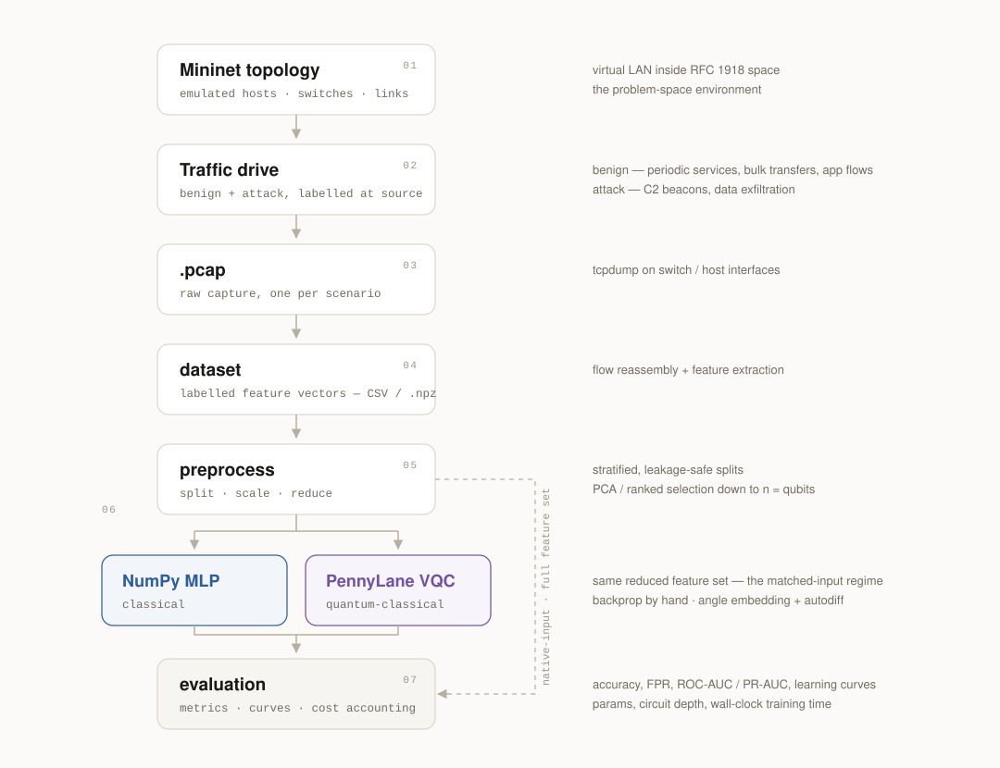

# q-ids

**Problem-space adversarial robustness of ML-based network intrusion detection.** How much
*realizable* traffic change does it take for an attack to slip past a trained flow-level detector,
measured on real traffic rather than on the feature vector, and does a quantum-classical classifier
(PennyLane VQC) hold up any better than a classical one (NumPy MLP)?

> **Status:** experiments complete for two attack families (C2 beaconing and data exfiltration).
> The paper is being prepared for *Computers & Security* in [`paper/tex/`](paper/tex/).

## Key findings

| | C2 beaconing | Data exfiltration |
|---|---|---|
| What the detector keys on | timing regularity (`cv_iat`) | throughput (`bytes_per_second`) |
| Clean accuracy (MLP / VQC) | 0.857 / 0.746 | 0.847 / 0.833 |
| Evaded after a realizable change | 100% of instances (timing jitter) | 100% of instances (rate throttling) |
| Quantum robustness advantage | none (VQC equal or easier to evade) | none (VQC easier to evade in 15/15) |
| Adversarial training | closes the timing axis; the size axis then re-breaks it (100%) | closes the throttle axis for the MLP; VQC stays evadable |

Clean accuracy is deliberately *not* 100%: the benign traffic includes services that genuinely
resemble the attack (regular health checks for C2, large legitimate transfers for exfiltration). An
earlier saturated version of the task produced an apparent quantum "edge" that disappeared once
detection was made realistic.

## Problem space, not feature space

- A **feature-space** attack edits the feature vector directly (`x' = x + δ`). The result may not
  correspond to any traffic that could actually be sent.
- A **problem-space** attack changes the *traffic itself*: the candidate is generated as real packets,
  captured, run through the detector's own feature pipeline, and scored.

Here every candidate is also checked by a **functional oracle**: an evasion only counts if the attack
still works (the beacon keeps checking in; the full payload still arrives before a deadline).
Both detectors are trained on **matched inputs** (the same 8 PCA components), so any robustness
difference comes from the model, not from what it sees.

## Pipeline

<picture>
  <source media="(prefers-color-scheme: dark)" srcset="docs/pipeline-dark.svg">
  
</picture>

1. **Traffic** is generated in an emulated Mininet network (10 Mbit/s links, NIC offloads off) and
   captured with tcpdump. Labels are exact by construction: each flow is labelled by its sender's role.
2. **Features**: packets are grouped into flows keyed by (protocol, source MAC, destination), and 17
   flow statistics are extracted ([`features/dataset.py`](features/dataset.py)).
3. **Detectors**: a from-scratch NumPy MLP (no ML framework) and a PennyLane VQC (8 qubits, 4
   entangling layers, `default.qubit` simulator).
4. **Evasion**: a capture-once sweep over one realizable parameter, scored offline against every
   detector, so all models are compared on identical traffic. This yields paired comparisons and
   transfer rates.
5. **Defense**: adversarial training on evaded samples, evaluated on held-out instances, then a second
   realizable parameter is tested against the hardened detector.

## Repository layout

```
q-ids/
├── topology/      Mininet topology and batch scenario runner
├── traffic/       traffic generators (periodic client, exfil client/sink, benign services)
├── capture/       tcpdump wrapper (runs inside the host's network namespace)
├── features/      flow feature extraction, dataset utilities, shared preprocessing
├── models/        NumPy MLP (+ gradient check) and PennyLane VQC, with trainers
├── evaluation/    from-scratch metrics and the model comparison harness
├── evasion/       query primitive, functional oracles, sweeps, transfer, hardening
├── configs/       model configs and scenario configs (c2.yaml, exfil.yaml)
├── results/       model metadata and evasion results (JSON/NPZ)
└── paper/         LaTeX source, figure script, section drafts
```

`configs/scenarios/{synflood,recon,spoof,mixed,benign}.yaml` and `traffic/attack/` belong to an
earlier design. They are kept for history and are not used by the paper.

## Prerequisites

- **Linux** for traffic generation (Mininet needs network namespaces and Open vSwitch). Training,
  evaluation and offline scoring run anywhere.
- System packages: `mininet openvswitch-switch tcpdump ethtool` (Arch: Mininet from the AUR).
- Capture steps need root. **All traffic is confined to the emulated Mininet hosts** (private
  addresses inside the virtual topology). Do not point any generator at real networks.

## Setup

```bash
git clone https://github.com/shek014/q-ids.git
cd q-ids
python -m venv .venv && source .venv/bin/activate
pip install -r requirements.txt          # pinned versions used for the paper (Python 3.14)
```

Mininet lives in the system Python; the models live in the venv. The capture half of each query is
run by `/usr/bin/python3`, the scoring half by `.venv/bin/python`. Before any capture:

```bash
sudo modprobe openvswitch veth
sudo systemctl start ovsdb-server ovs-vswitchd
```

## Reproducing the results

```bash
# 1. collect a dataset (Linux, root) and extract features
sudo python3 -m topology.run --scenario configs/scenarios/c2.yaml --out capture/c2 --runs 60
python -m features.extract --pcap-dir capture/c2 --out data/dataset.npz

# 2. train the detectors (native MLP, matched MLP, VQC) and compare
python -m models.classical.train --data data/dataset.npz --out results/classical_native
python -m models.classical.train --data data/dataset.npz --out results/classical_matched --pca-components 8
python -m models.quantum.train   --data data/dataset.npz --out results/quantum
python -m evaluation.compare --out results/comparison

# 3. capture-once sweep (root), then offline scoring, hardening and held-out evaluation
sudo .venv/bin/python -m evasion.sweep --seeds 15 --out results/evasion/sweep.npz
python -m evasion.transfer --sweep results/evasion/sweep.npz
python -m evasion.harden --sweep results/evasion/sweep.npz --adv-seeds 0-9
python -m evasion.harden_eval --sweep results/evasion/sweep.npz --heldout 10-14

# 4. figures (then copy the PDFs into paper/tex/figures/)
python paper/make_figures.py
```

The exfiltration study mirrors these steps with `configs/scenarios/exfil.yaml`,
`features.extract --classes benign,exfil`, and the `evasion/exfil_*` modules.

## Non-goals

- **Quantum advantage.** Nothing runs on quantum hardware; `default.qubit` is a classical simulator.
  The VQC is one architecture under test.
- **Feature-space results presented as realizable.** Every reported evasion was generated as real
  traffic and passed the functional oracle.
- **Benchmark leaderboard numbers.** The traffic is self-generated in an emulated testbed, so absolute
  accuracy is not comparable to CIC-IDS2017 or UNSW-NB15 results. A benchmark cross-check is planned as
  separate work.
- **General-purpose intrusion detection.** The study covers two attack families whose function is
  separable from their traffic shape. Volumetric attacks (floods, scans) are out of scope, because their
  detectable signature *is* their function.

## Citation

Code and data are archived on Zenodo: [10.5281/zenodo.23180178](https://doi.org/10.5281/zenodo.23180178).

## License

MIT, see [LICENSE](LICENSE). Copyright (c) 2026 Abhishek Ravicharan.
